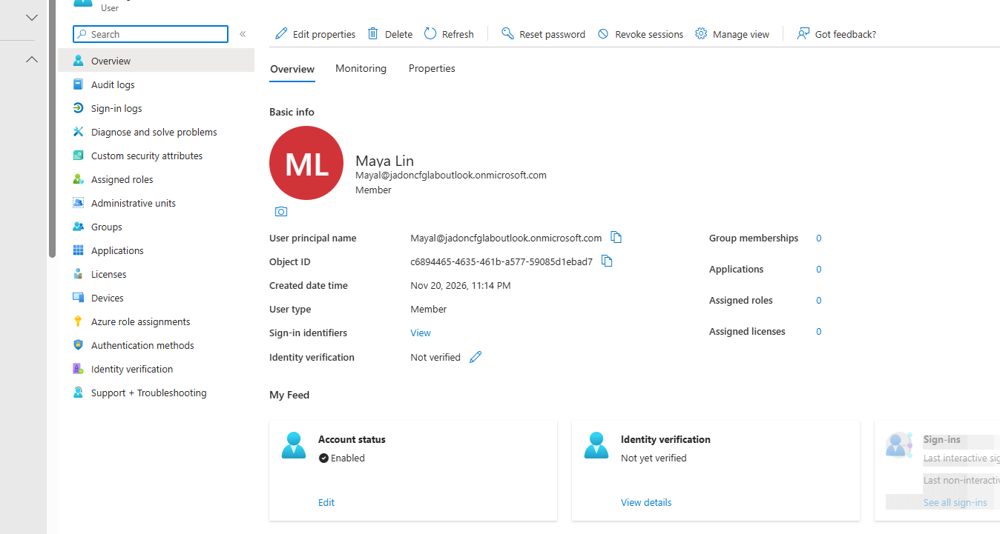
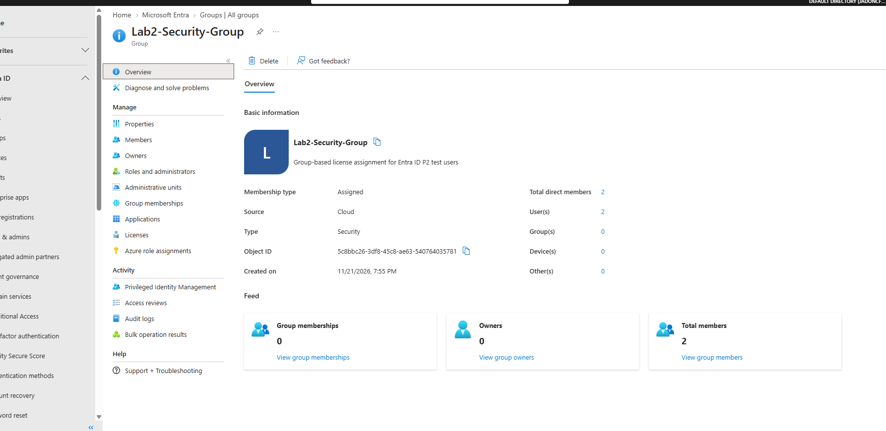
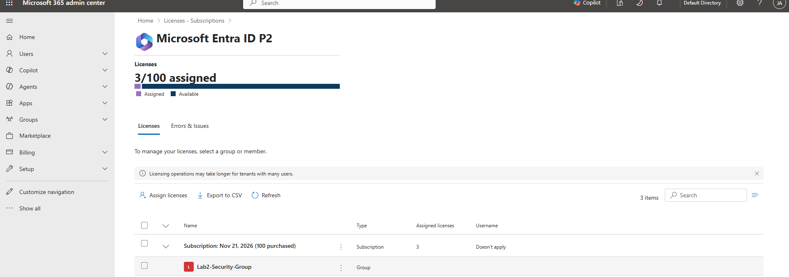
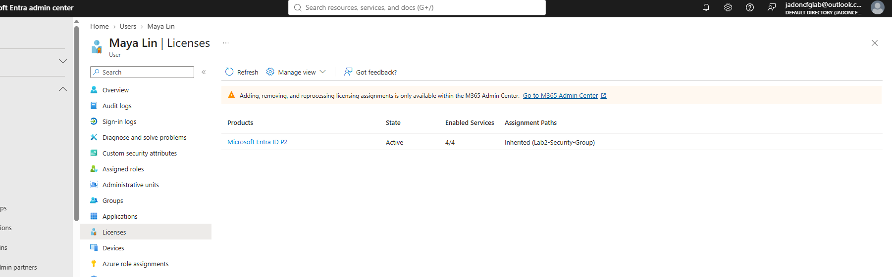
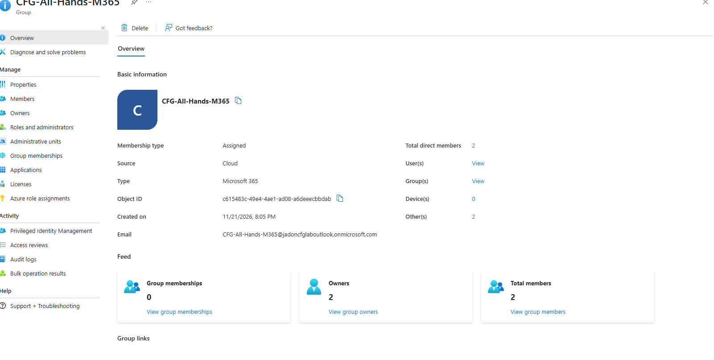
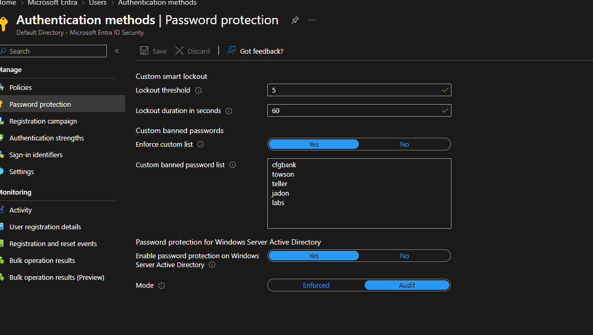
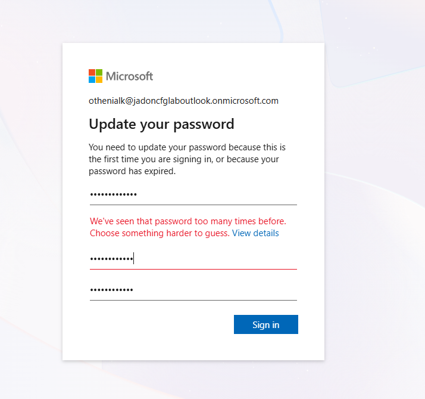
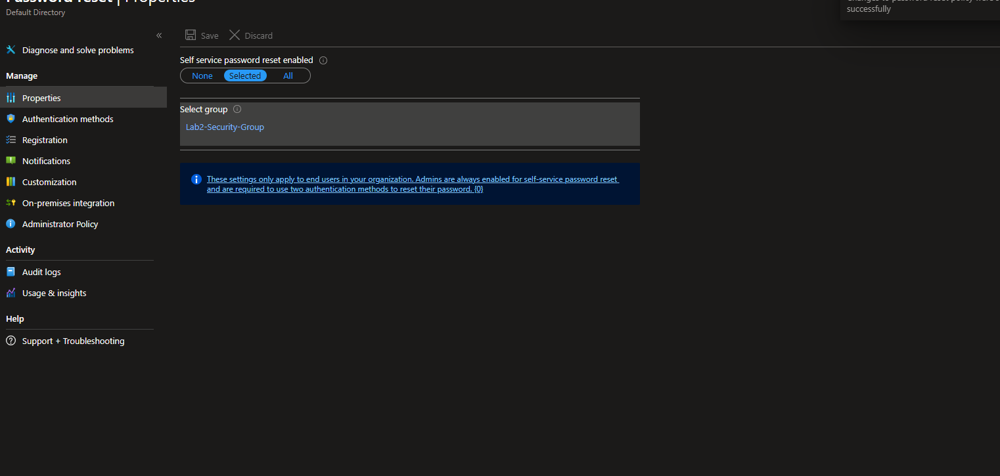
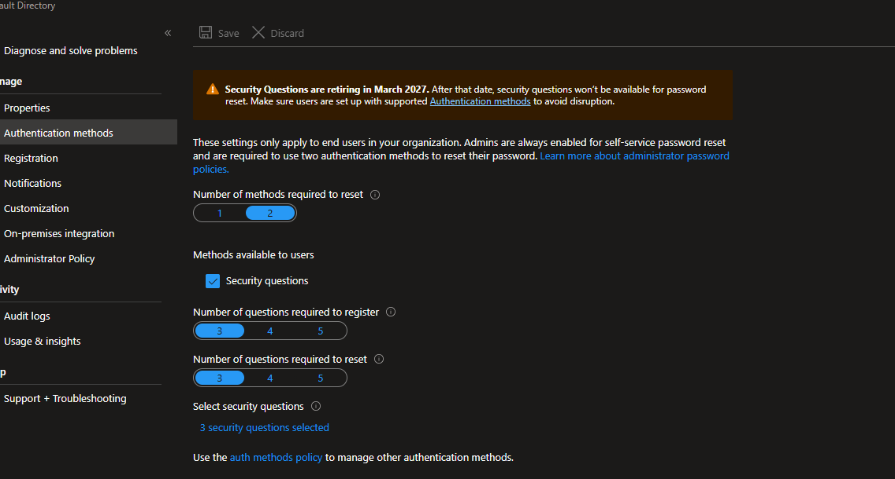
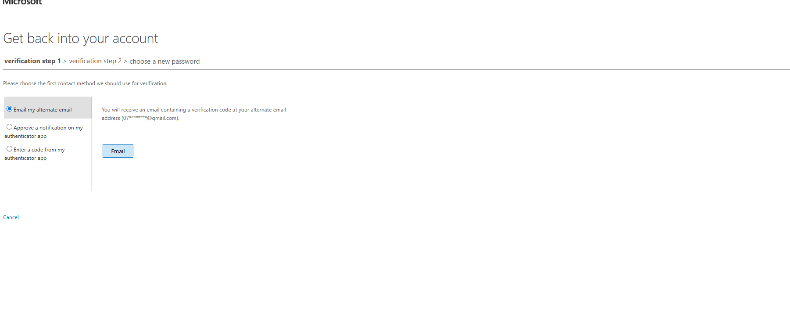

# Entra-ID-Labs-

# Microsoft Entra ID Basics & Cloud Identity Lab

## Project Overview
This repository documents my hands-on lab work learning cloud Identity and Access Management (IAM) fundamentals inside Microsoft Entra ID. Before connecting my on-premises Active Directory environment to the cloud for hybrid identity synchronization, I built a standalone cloud tenant (`://onmicrosoft.com`) to practice user lifecycle provisioning, Role-Based Access Control (RBAC), SaaS license management, and B2B guest collaboration.

---

## Weekend 1: Core Cloud Identity, Licensing & Access Control (Nov 20–22, 2026)

### Lab 1: Tenant Setup, User Provisioning & Access Administration

#### 1. Tenant Isolation & Administrative Separation
* **What I Built:** Set up an isolated Microsoft Entra ID workforce directory (`://onmicrosoft.com`) and created a dedicated cloud administrator account (`JadonAdmin`) with the **Global Administrator** role.
* **Why It Matters in IAM:** Separating a daily login from a dedicated administrative account reduces the risk of accidental configuration changes and follows the Principle of Least Privilege.

#### 2. Cloud User Provisioning & Authentication Verification
* **What I Built:** Created a standard cloud user account for **Keith Mazinga** (`KeithM@://onmicrosoft.com`), configured required directory attributes including `Usage location` (`United States`), and verified end-user authentication through the Microsoft My Apps / Microsoft 365 portal.
* **Why It Matters in IAM:** In enterprise onboarding, creating an account is only the first step—verifying first-time password resets and portal access ensures a new hire can actually authenticate before tickets start coming in.

#### 3. License Provisioning & Usage Location Enforcement
* **What I Built:** Activated a Microsoft Entra ID P2 evaluation license pool and assigned a license directly to Keith Mazinga through the Microsoft 365 Admin Center, verifying the entitlement synced back to Entra ID (`1/100 assigned`).
* **Why It Matters in IAM:** Identity creation and license assignment are separate layers. Setting a user's `Usage location` is a mandatory prerequisite in Entra ID because cloud service availability and compliance rules are tied to geographic region. Missing this attribute is a common cause of automated onboarding failures.

#### 4. B2B Guest Collaboration & Delegated RBAC
* **What I Built:** Invited an external contractor account using Microsoft Entra B2B collaboration (creating a `#EXT#` guest identity) and assigned the **Attribute Definition Reader** built-in role to Keith Mazinga.
* **Why It Matters in IAM:** External vendors need controlled access to internal resources without receiving full employee privileges, while built-in RBAC roles let helpdesk or junior analysts read specific directory metadata without granting unnecessary write access.

#### 5. Directory Population & Bulk Provisioning Concepts
* **What I Built:** Provisioned additional employee test accounts (**Maya Lin** and **Devon Brooks**) to prepare the directory for group-based access control and reviewed Entra ID's CSV bulk-import schema (`UserCreateTemplate.csv`) for mass onboarding workflows.
* **Why It Matters in IAM:** Manual user creation works for one-off requests, but understanding bulk CSV ingestion and attribute mapping is essential when onboarding large groups of hires or preparing for automated HR-driven provisioning.

---

# Lab 2: Basic Group Management & Group-Based Licensing

## What I Did
In this lab, I set up two different types of groups in Microsoft Entra ID (`://onmicrosoft.com`)—a Security Group and a Microsoft 365 Group—and configured group-based licensing so test users automatically inherit their Microsoft Entra ID P2 licenses instead of me assigning them one by one.

---

## Why This Matters in IAM
* **Security Groups vs. Microsoft 365 Groups:** Security groups are used to control access permissions and license assignments, while Microsoft 365 groups are built for team collaboration and come with a shared group email address.
* **Group-Based Licensing:** Assigning licenses one user at a time does not scale in a real company. By tying a license to a security group, users automatically inherit the entitlement when they are added to the group and lose it when they are removed.
* **Group Ownership:** Assigning owners to a group establishes accountability for who manages membership and approves future access reviews.

---

## Walkthrough & Verification

### 1. Created a Security Group (`Lab2-Security-Group`)
I created a cloud Security Group with assigned membership and added two test users (`Maya Lin` and `Devon Brooks`) so I could manage their licenses together.

### 2. Assigned the Entra ID P2 License to the Group
Instead of assigning licenses individually like I did for Keith Mazinga in Lab 1, I went into the Microsoft 365 admin center and assigned the **Microsoft Entra ID P2** license pool directly to `Lab2-Security-Group`. This bumped our active license usage from `1/100` to `3/100`.

### 3. Verified Inherited License Assignment
I checked `Maya Lin`'s profile in the Entra admin center to make sure the license applied properly. Under **Assignment Paths**, it confirmed her **Microsoft Entra ID P2** license (`4/4` services enabled) was **Inherited** from `Lab2-Security-Group`.

### 4. Created a Microsoft 365 Group (`CFG-All-Hands-M365`)
Next, I created an assigned Microsoft 365 group with its own group email (`CFG-All-Hands-M365@://onmicrosoft.com`), set `2` owners, and added `2` direct members.

## Key IAM Takeaways From Lab 1
* **Identity vs. Entitlements:** Provisioning a User Principal Name (UPN) only establishes authentication; licenses and RBAC roles control what services and administrative views the user can actually access.
* **Attribute Dependencies:** Directory attributes like `Usage location` directly impact downstream license assignments and automation scripts.
* **Admin Boundary Awareness:** Consumer Microsoft accounts cannot manage Microsoft 365 licensing portals, requiring a dedicated `@onmicrosoft.com` organizational admin account.

# Lab 3: Password Protection & Smart Lockout

## What I Did
In this lab, I configured Microsoft Entra Password Protection and Smart Lockout in my tenant (`jadoncfglaboutlook.onmicrosoft.com`) to stop users from choosing predictable, organization-related passwords and to block brute-force sign-in attempts against test accounts.

---

## Why This Matters in IAM
* **Custom Banned Passwords:** Even when passwords meet standard length and complexity rules, attackers still guess variations tied to the company's name, location, or job roles (such as `CFGBank2026!`). Enforcing a custom banned password list blocks those predictable patterns automatically.
* **Smart Lockout:** Standard account lockouts let attackers intentionally lock out real employees by spamming failed logins. Smart Lockout tracks familiar versus unfamiliar locations and ignores repeated guesses of the last three wrong passwords so legitimate users stay working while brute-force attacks get blocked.
* **Audit Mode Preparation:** Enabling Windows Server Active Directory password protection in **Audit** mode lets an IAM team monitor how password policies affect on-premises accounts without unexpectedly blocking users before full hybrid rollout.

---

## Walkthrough & Verification

### 1. Configured Smart Lockout & Custom Banned Passwords
In the Microsoft Entra admin center under **Authentication methods > Password protection**, I configured:
* **Lockout threshold:** `5` failed attempts
* **Lockout duration in seconds:** `60` seconds
* **Custom banned password list:** Enabled with `cfgbank`, `towson`, `teller`, `jadon`, and `labs`
* **Windows Server Active Directory password protection:** Enabled in **Audit** mode to prepare for future on-premises Active Directory integration

### 2. Verified Custom Banned Password Enforcement
I signed in as test user `othenialk@jadoncfglaboutlook.onmicrosoft.com` during a required first-time password update and attempted to use a password containing one of my custom banned keywords. Entra Password Protection rejected the password immediately and prompted for a stronger choice.

### 3. Tested & Verified Smart Lockout (`AADSTS50053`)
Next, I tested Smart Lockout on `chimaa@jadoncfglaboutlook.onmicrosoft.com` by entering consecutive unique invalid passwords past the configured lockout threshold. Once the threshold was crossed, Entra triggered a temporary lockout (`Your account is temporarily locked to prevent unauthorized use`) to block further brute-force attempts.

# Lab 4: Self-Service Password Reset (SSPR)

## What I Did
In this lab, I configured and tested Microsoft Entra Self-Service Password Reset (SSPR) in my tenant (`://onmicrosoft.com`) so users in a targeted security group can register recovery methods at sign-in and reset forgotten passwords on their own without calling the IT help desk.

---

## Why This Matters in IAM
* **Scoped Pilot Rollout (`Selected` Group):** Rather than turning SSPR on for an entire company at once, IAM teams scope policies to a specific security group (`Lab2-Security-Group`) first to validate behavior before broad deployment.
* **Multi-Factor Identity Proofing:** Requiring `2` authentication methods (such as Email OTP plus Microsoft Authenticator) ensures an attacker cannot take over an account just by compromising a single recovery channel.
* **Reduced Help Desk Ticket Volume:** Password resets are one of the highest-volume IT support requests. Automated SSPR registration at sign-in ensures users set up recovery methods proactively while keeping password changes subject to Entra Password Protection rules.

---

## Walkthrough & Verification

### 1. Scoped SSPR to a Security Group
In the Microsoft Entra admin center under **Password reset > Properties**, I set **Self service password reset enabled** to **Selected** and targeted `Lab2-Security-Group`.

### 2. Configured Two-Method Verification Policy
Under **Password reset > Authentication methods**, I set the **Number of methods required to reset** to `2` and configured the unified **Authentication methods policy** so users can register and verify with **Email OTP** and **Microsoft Authenticator**.

### 3. Registered Recovery Methods & Initiated SSPR
After adding test user `chimaa@://onmicrosoft.com` to `Lab2-Security-Group`, I completed the mandatory sign-in registration prompt and initiated a password reset via **Forgot my password**, verifying both **verification step 1** (alternate email code) and **verification step 2** (Microsoft Authenticator).

### 4. Confirmed Successful Password Reset
After passing both verification challenges and setting a new password compliant with our Lab 3 custom banned password list, Entra confirmed the reset (`Your password has been reset`).

