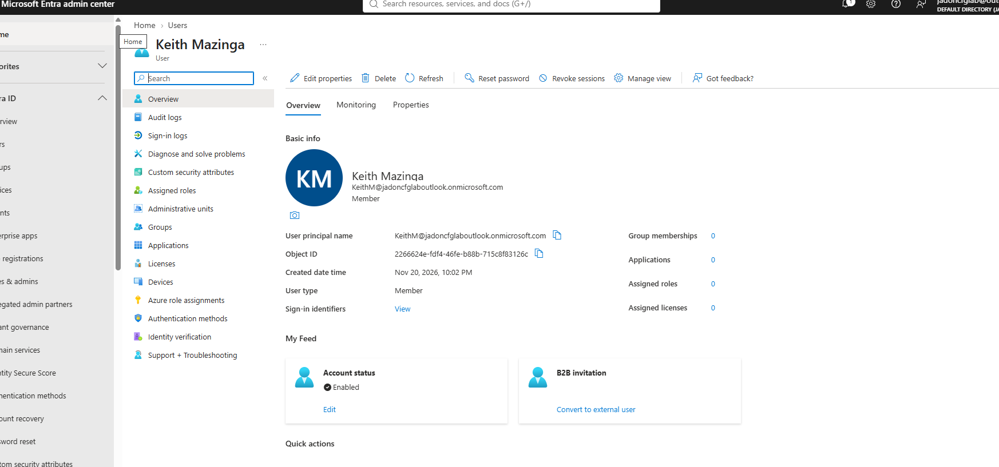
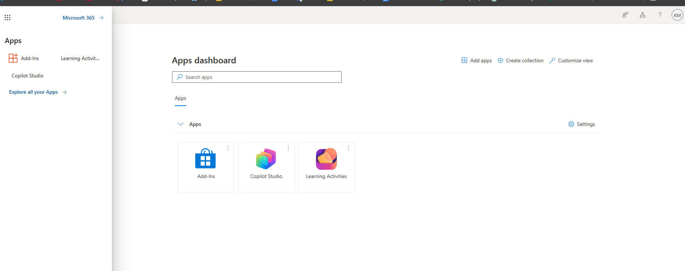
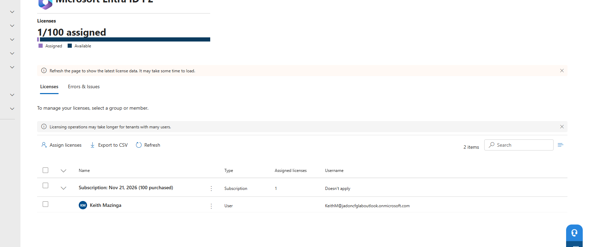
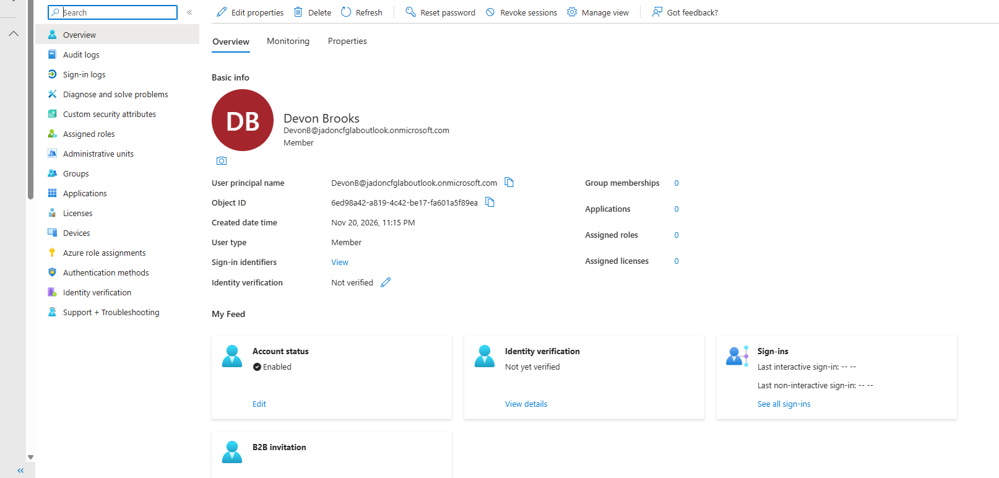

# Entra-ID-Labs-

# Microsoft Entra ID Basics & Cloud Identity Lab

## Project Overview
This repository documents my hands-on lab work learning cloud Identity and Access Management (IAM) fundamentals inside Microsoft Entra ID. Before connecting my on-premises Active Directory environment to the cloud for hybrid identity synchronization, I built a standalone cloud tenant (`://onmicrosoft.com`) to practice user lifecycle provisioning, Role-Based Access Control (RBAC), SaaS license management, and B2B guest collaboration.

---

## Weekend 1: Core Cloud Identity, Licensing & Access Control (Nov 20–22, 2026)

### Lab 1: Tenant Setup, User Provisioning & Access Administration

#### 1. Tenant Isolation & Administrative Separation
* **What I Built:** Set up an isolated Microsoft Entra ID workforce directory (`://onmicrosoft.com`) and created a dedicated cloud administrator account (`JadonAdmin`) with the **Global Administrator** role.
* **Why It Matters in IAM:** Separating a daily login from a dedicated administrative account reduces the risk of accidental configuration changes and follows the Principle of Least Privilege.

#### 2. Cloud User Provisioning & Authentication Verification
* **What I Built:** Created a standard cloud user account for **Keith Mazinga** (`KeithM@://onmicrosoft.com`), configured required directory attributes including `Usage location` (`United States`), and verified end-user authentication through the Microsoft My Apps / Microsoft 365 portal.
* **Why It Matters in IAM:** In enterprise onboarding, creating an account is only the first step—verifying first-time password resets and portal access ensures a new hire can actually authenticate before tickets start coming in.

#### 3. License Provisioning & Usage Location Enforcement
* **What I Built:** Activated a Microsoft Entra ID P2 evaluation license pool and assigned a license directly to Keith Mazinga through the Microsoft 365 Admin Center, verifying the entitlement synced back to Entra ID (`1/100 assigned`).
* **Why It Matters in IAM:** Identity creation and license assignment are separate layers. Setting a user's `Usage location` is a mandatory prerequisite in Entra ID because cloud service availability and compliance rules are tied to geographic region. Missing this attribute is a common cause of automated onboarding failures.

#### 4. B2B Guest Collaboration & Delegated RBAC
* **What I Built:** Invited an external contractor account using Microsoft Entra B2B collaboration (creating a `#EXT#` guest identity) and assigned the **Attribute Definition Reader** built-in role to Keith Mazinga.
* **Why It Matters in IAM:** External vendors need controlled access to internal resources without receiving full employee privileges, while built-in RBAC roles let helpdesk or junior analysts read specific directory metadata without granting unnecessary write access.

#### 5. Directory Population & Bulk Provisioning Concepts
* **What I Built:** Provisioned additional employee test accounts (**Maya Lin** and **Devon Brooks**) to prepare the directory for group-based access control and reviewed Entra ID's CSV bulk-import schema (`UserCreateTemplate.csv`) for mass onboarding workflows.
* **Why It Matters in IAM:** Manual user creation works for one-off requests, but understanding bulk CSV ingestion and attribute mapping is essential when onboarding large groups of hires or preparing for automated HR-driven provisioning.

---

# Lab 2: Basic Group Management & Group-Based Licensing

## What I Did
In this lab, I set up two different types of groups in Microsoft Entra ID (`://onmicrosoft.com`)—a Security Group and a Microsoft 365 Group—and configured group-based licensing so test users automatically inherit their Microsoft Entra ID P2 licenses instead of me assigning them one by one.

---

## Why This Matters in IAM
* **Security Groups vs. Microsoft 365 Groups:** Security groups are used to control access permissions and license assignments, while Microsoft 365 groups are built for team collaboration and come with a shared group email address.
* **Group-Based Licensing:** Assigning licenses one user at a time does not scale in a real company. By tying a license to a security group, users automatically inherit the entitlement when they are added to the group and lose it when they are removed.
* **Group Ownership:** Assigning owners to a group establishes accountability for who manages membership and approves future access reviews.

---

## Walkthrough & Verification

### 1. Created a Security Group (`Lab2-Security-Group`)
I created a cloud Security Group with assigned membership and added two test users (`Maya Lin` and `Devon Brooks`) so I could manage their licenses together.

### 2. Assigned the Entra ID P2 License to the Group
Instead of assigning licenses individually like I did for Keith Mazinga in Lab 1, I went into the Microsoft 365 admin center and assigned the **Microsoft Entra ID P2** license pool directly to `Lab2-Security-Group`. This bumped our active license usage from `1/100` to `3/100`.

### 3. Verified Inherited License Assignment
I checked `Maya Lin`'s profile in the Entra admin center to make sure the license applied properly. Under **Assignment Paths**, it confirmed her **Microsoft Entra ID P2** license (`4/4` services enabled) was **Inherited** from `Lab2-Security-Group`.

### 4. Created a Microsoft 365 Group (`CFG-All-Hands-M365`)
Next, I created an assigned Microsoft 365 group with its own group email (`CFG-All-Hands-M365@://onmicrosoft.com`), set `2` owners, and added `2` direct members.

## Key IAM Takeaways From Lab 1
* **Identity vs. Entitlements:** Provisioning a User Principal Name (UPN) only establishes authentication; licenses and RBAC roles control what services and administrative views the user can actually access.
* **Attribute Dependencies:** Directory attributes like `Usage location` directly impact downstream license assignments and automation scripts.
* **Admin Boundary Awareness:** Consumer Microsoft accounts cannot manage Microsoft 365 licensing portals, requiring a dedicated `@onmicrosoft.com` organizational admin account.
